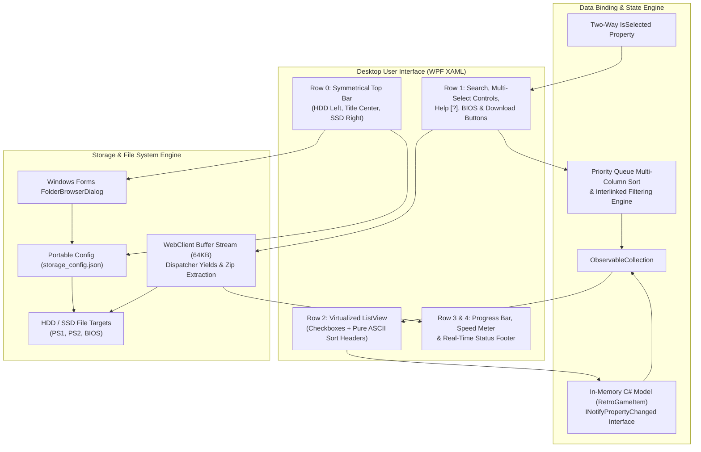
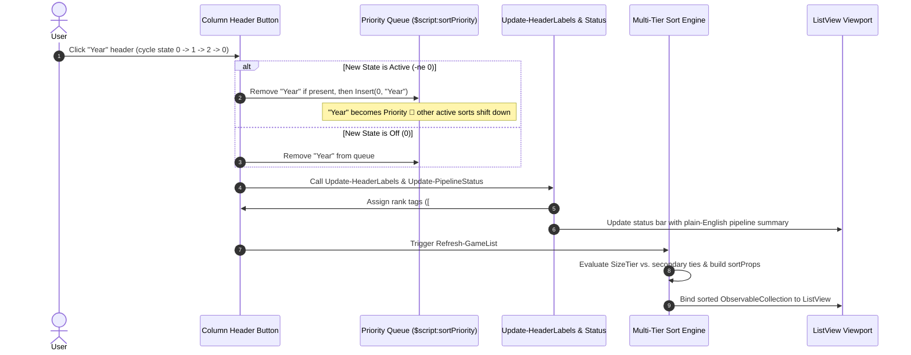
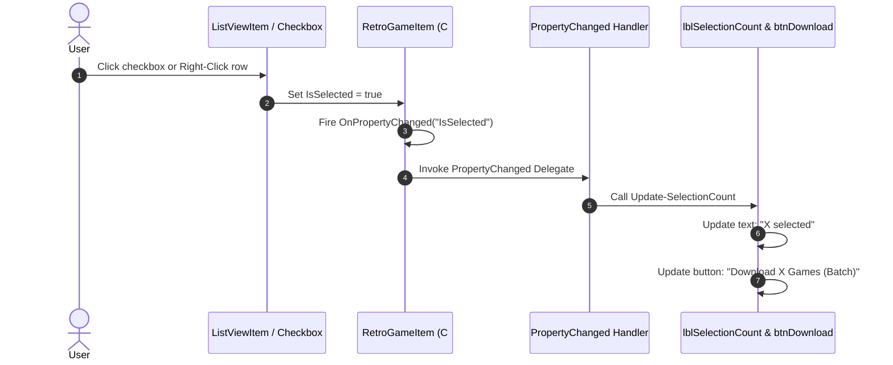
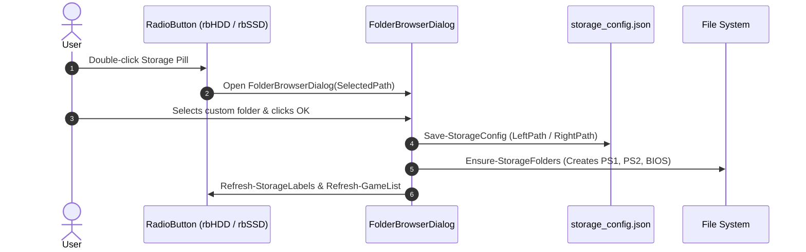

# System Architecture (`ARCHITECTURE.md`)
> **1-Line Summary:** Plain-English visual map of how Retro Console Manager works, why we chose each component, and step-by-step recipes for maintaining and extending it.

## 1. High-Level Visual System Map



---

## 2. Tech Stack & Why We Chose It

| Layer | Tool / Library | Plain-English Reason Why |
| --- | --- | --- |
| **GUI Framework** | Windows Presentation Foundation (WPF XAML) | Built natively into Windows 10/11; provides GPU-accelerated 60 FPS rendering and styling without heavy node/electron runtimes. |
| **Data Binding** | Inline C# Class (`RetroGameItem`) via `Add-Type` | Raw PowerShell script blocks fail two-way WPF databinding; compiled C# implementing `INotifyPropertyChanged` delivers instant checkbox updates. |
| **Runtime Host** | Windows PowerShell 5.1+ (`-STA`) | Standard preinstalled shell on every modern Windows PC; requires zero installer dependencies. |
| **Storage Selection** | `System.Windows.Forms.FolderBrowserDialog` | Native Windows folder browser that lets users choose any drive or path directly. |
| **Catalog Storage** | JSON (`games_catalog.json`) | Human-readable, git-friendly, easily extensible structured format for game metadata. |

---

## 3. Core Subsystems & Engineering Mechanics

### [SUBSYSTEM: Priority-Queue-Multi-Sorting] | Aliases: multi sort, sort priority, column sorting, size tier grouping
> **1-Line Summary:** Most-Recently-Changed dynamic priority queue (`[#1]`, `[#2]`, `[#3]`) and Size-Tier multi-sort engine.

* **How It Works (Plain English):** All 4 sortable columns (`Size`, `Year`, `Genre`, `Title`) participate in an ordered `$script:sortPriority` queue. Under the **Most-Recently-Changed rule**, clicking ANY sortable header removes it from its current position and inserts it at index 0, guaranteeing that whichever column the user just adjusted instantly commands Priority `#1` while earlier sort choices shift down to `#2`, `#3`, etc.
* **Solving the Raw-Byte Tie Problem (Size Tier Grouping):** When sorting by exact file sizes, almost every game has a unique byte count (e.g., 310 MB vs. 320 MB), which previously left zero ties for secondary sorts like Year or Genre to organize. When Size is placed above Year or Genre in the priority queue, the engine groups games by `SizeTier` (1 = <500MB, 2 = 500MB-1GB, 3 = 1GB-2GB, 4 = 2GB-3.5GB, 5 = >=3.5GB), applies the secondary sort (e.g. Year) inside that tier, and finally orders by exact `SizeBytes`.
* **Data Flow Diagram:**



* **Code Anchors (Grep Targets):**
  * `retro-console-manager.ps1` -> `$script:sortPriority`, `Update-HeaderLabels`, `Update-PipelineStatus`, `SizeTier`, `Refresh-GameList`

---

### [SUBSYSTEM: Two-Way-Bound-Multi-Select] | Aliases: row selection, checkbox binding, notify property changed
> **1-Line Summary:** High-performance two-way data-bound selection mechanism responsive to checkboxes, left-clicks, and right-clicks.

* **How It Works (Plain English):** Each row is bound to a native C# `RetroGameItem` object. When a user clicks a checkbox, left-clicks a row, or right-clicks anywhere on the item, the `IsSelected` property toggles. `OnPropertyChanged("IsSelected")` fires, notifying the WPF UI and triggering `$lblSelectionCount` to update instantly. Selections are preserved during search and filter operations.
* **Data Flow Diagram:**



* **Code Anchors (Grep Targets):**
  * `retro-console-manager.ps1` -> `RetroGameItem`, `_isSelected`, `Update-SelectionCount`, `lvGames.Add_MouseRightButtonUp`

---

### [SUBSYSTEM: Double-Click-Custom-Storage-Engine] | Aliases: folder browser, storage config, custom path
> **1-Line Summary:** Automatic storage path detection, folder structure provisioning (`PS1/`, `PS2/`, `BIOS/`), and interactive folder selection.

* **How It Works (Plain English):** On startup, `Load-StorageConfig` checks `storage_config.json`. If missing, it defaults to `E:\Cracked\Console_Games` (if E: exists) or the user profile folder, and `C:\Retro_Games\Console_Games`. Double-clicking either storage pill launches `System.Windows.Forms.FolderBrowserDialog`. Once a folder is chosen, the new path is validated, saved to `storage_config.json`, and the directory tree is automatically created.
* **Data Flow Diagram:**



* **Code Anchors (Grep Targets):**
  * `retro-console-manager.ps1` -> `Load-StorageConfig`, `Save-StorageConfig`, `Ensure-StorageFolders`, `Select-CustomStorageFolder`, `Refresh-StorageLabels`

---

## 4. Verification & Health Checks

### [VERIFY: Automated-Check-Suite] | Aliases: test commands, build check, audit
> **1-Line Summary:** Mandatory commands to verify syntax, encoding, and WPF data binding before submitting any changes.

* **AST Parser Check & ASCII Purity:**
  ```powershell
  powershell -NoProfile -ExecutionPolicy Bypass -Command "& { `$txt = [System.IO.File]::ReadAllText('retro-console-manager.ps1', [System.Text.Encoding]::UTF8); `$errors = `$null; [System.Management.Automation.Language.Parser]::ParseInput(`$txt, [ref]`$null, [ref]`$errors); if (`$errors.Count -gt 0) { exit 1 }; Write-Host 'Syntax OK' }"
  ```
* **Automated Data Binding & UI Initialization:**
  ```powershell
  powershell -NoProfile -ExecutionPolicy Bypass -Command "& { Add-Type -AssemblyName PresentationFramework, PresentationCore, WindowsBase, System.Windows.Forms; `$code = Get-Content 'retro-console-manager.ps1' -Raw; `$testBlock = `$code -replace '\$window\.ShowDialog\(\)\s*\|\s*Out-Null', '# Test'; . ([scriptblock]::Create(`$testBlock)); Write-Host \"Loaded `$(`$displayedModels.Count) games.\" }"
  ```

---

## 5. Recipes: How to Add New Things Safely

### Adding New Games to the Catalog
1. Open `games_catalog.json`.
2. Append a new object following this structure:
   ```json
   {
       "id": 59,
       "platform": "PS2",
       "title": "Shadow of the Colossus",
       "genre": "Action / Adventure",
       "size": "950 MB",
       "fileName": "Shadow of the Colossus (USA).chd",
       "url": "https://archive.org/download/.../Shadow%20of%20the%20Colossus.chd",
       "year": 2005,
       "graphics": "High (Realistic)"
   }
   ```
3. Run the automated check suite to verify parsing.
