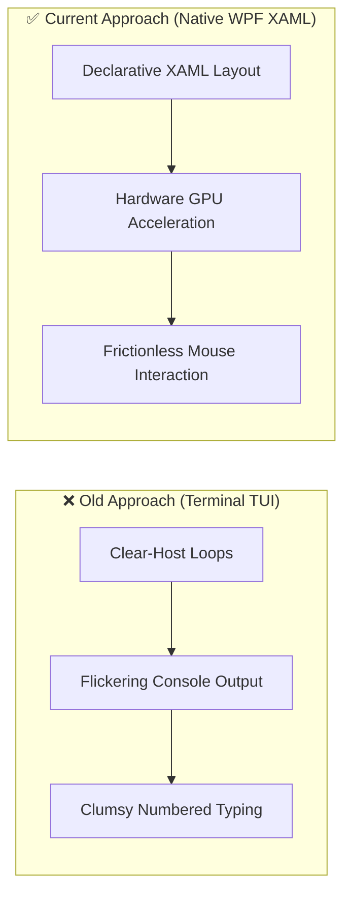
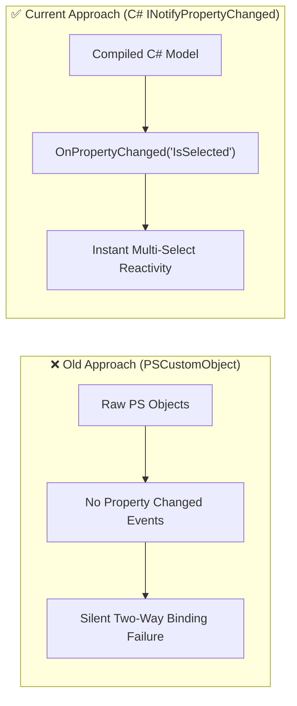
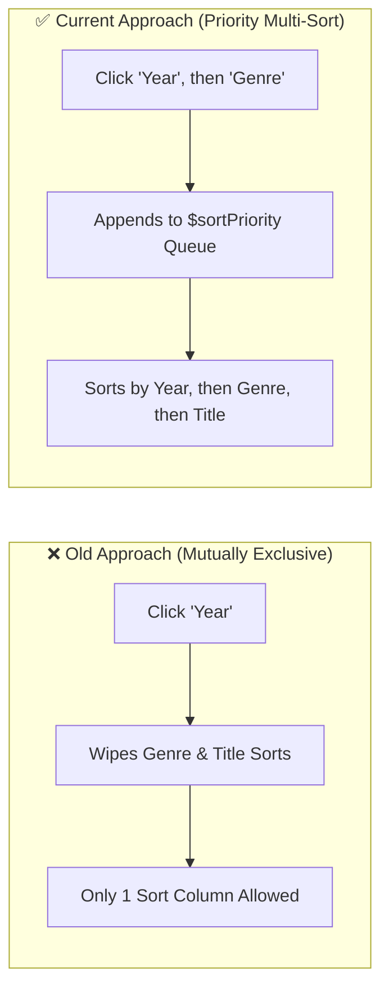
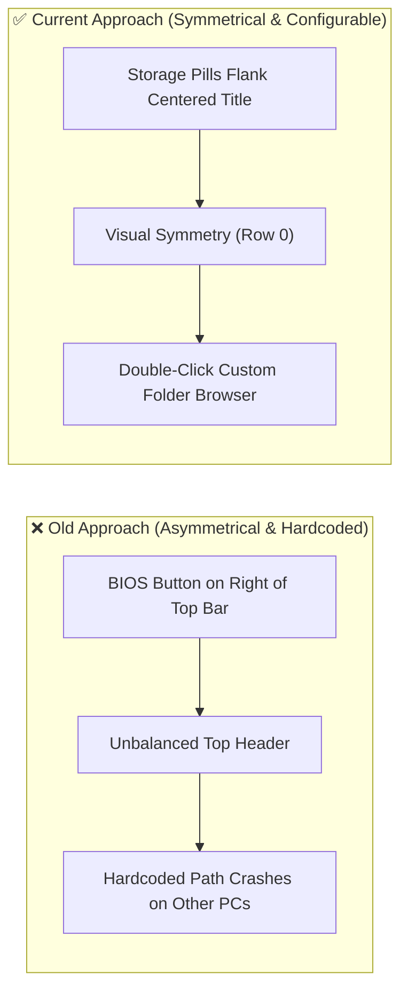

# Architectural Decisions, Pivots & Landmines (`DECISIONS_AND_TRAPS.md`)
> **1-Line Summary:** Records why specific architectural decisions were chosen, what failed when attempting alternatives, decision makers, and critical code traps never to touch.

## 1. Architectural Decisions & Pivot History

### [DECISION: Terminal-TUI-To-Native-WPF-GUI] | Aliases: terminal tui, console ui, wpf pivot
> **1-Line Summary:** Replaced flickering PowerShell console menus with a hardware-accelerated declarative WPF XAML desktop window.
* **Decision Maker:** `[DECIDED BY: HUMAN]`
* **Original User Intention:** A smooth, readable, and modern interface for browsing and downloading retro games without console scrolling artifacts.
* **Options Considered:**
  * **Option A (Rejected - Terminal TUI):** PowerShell console menus using `Clear-Host` and `Read-Host`. Suffered from severe screen flicker, inability to multi-select visually, and clumsy scrolling.
  * **Option B (Chosen - Native WPF GUI):** Declarative XAML with `PresentationFramework`. Native 60 FPS, modern dark-slate theme (`#0A0F1D`), virtualized table, and zero runtime dependencies.
* **Visual Pivot Map (What Failed vs. What Works):**

* **Code Anchors (Grep Targets):**
  * `retro-console-manager.ps1` -> `[xml]$xaml`, `[System.Windows.Markup.XamlReader]::Load`

---

### [DECISION: In-Memory-CSharp-Model-For-Two-Way-Binding] | Aliases: databinding fix, inotifypropertychanged, pscustomobject failure
> **1-Line Summary:** Replaced raw PowerShell `[PSCustomObject]` fields with a compiled in-memory C# class implementing `INotifyPropertyChanged` for instant WPF checkbox reactivity.
* **Decision Maker:** `[DECIDED BY: AGENT - Approved by Human]`
* **Original User Intention:** Checkbox selection must immediately update the selected counter and button label without full table re-renders.
* **Options Considered:**
  * **Option A (Rejected - PSCustomObject / PowerShell Class):** WPF data binding engine cannot subscribe to property change notifications on standard PowerShell objects or fields. Checkbox clicks failed to trigger UI updates.
  * **Option B (Chosen - Dynamic In-Memory C# Class):** Dynamically compile `RetroGameItem` via `Add-Type -TypeDefinition`. Fully implements `INotifyPropertyChanged` with native getter/setter properties.
* **Visual Pivot Map (What Failed vs. What Works):**

* **Code Anchors (Grep Targets):**
  * `retro-console-manager.ps1` -> `RetroGameItem`, `PropertyChangedEventHandler`, `OnPropertyChanged`

---

### [DECISION: Interlinked-Priority-Multi-Sort] | Aliases: combinable sorting, multi-sort, priority queue
> **1-Line Summary:** Upgraded mutually exclusive single-column sorting into a dynamic priority-queue multi-sort engine that keeps user click order intact.
* **Decision Maker:** `[DECIDED BY: HUMAN]`
* **Original User Intention:** Combine sorts across Year, Size, Genre, and Title without clicking one column resetting another.
* **Options Considered:**
  * **Option A (Rejected - Mutually Exclusive Sorting):** Clicking Year reset Genre, Title, and Size to default. Users could only sort by a single property at any given time.
  * **Option B (Chosen - Priority Queue Array):** Dynamic `$sortPriority` list tracks active sort columns in order of clicks. Generates composite `Sort-Object -Property @(sortProps)` expressions and highlights active headers in cyan (`#38BDF8`).
* **Visual Pivot Map (What Failed vs. What Works):**

* **Code Anchors (Grep Targets):**
  * `retro-console-manager.ps1` -> `$sortPriority`, `Refresh-GameList`, `hdrNo`

---

### [DECISION: Symmetrical-Top-Bar-With-Folder-Picker] | Aliases: top bar visual parity, double click folder picker, storage symmetry
> **1-Line Summary:** Moved the BIOS button to Row 1 and enabled double-click custom directory picking on the top bar storage pills for visual symmetry and portability.
* **Decision Maker:** `[DECIDED BY: HUMAN]`
* **Original User Intention:** Clean visual balance across the top bar and the ability to download to any custom directory on any machine.
* **Options Considered:**
  * **Option A (Rejected - Cluttered Asymmetrical Top Bar):** Right column contained both the SSD pill and the BIOS button, creating a visually lopsided header. Storage paths were hardcoded to `E:\Cracked\Console_Games`.
  * **Option B (Chosen - 3-Column Symmetry + Double-Click Selector):** Column 0 has HDD (Left), Column 1 has Title (Center), Column 2 has SSD (Right). Double-clicking either pill launches `FolderBrowserDialog` and saves to `storage_config.json`.
* **Visual Pivot Map (What Failed vs. What Works):**

* **Code Anchors (Grep Targets):**
  * `retro-console-manager.ps1` -> `rbHDD`, `rbSSD`, `btnBios`, `Select-CustomStorageFolder`, `Save-StorageConfig`

---

## 2. Do-Not-Touch Engineering Landmines (Traps)

### [TRAP: WPF-Property-Versus-Field-Binding] | Aliases: wpf binding bug, checkbox freeze
> **1-Line Summary:** Never replace C# properties with raw fields or PowerShell hashtables in the data model.
* **Strict Rule:** **NEVER** convert `RetroGameItem` into a pure PowerShell class or hashtable.
* **Why This Trap Exists (Plain English):** WPF's XAML `Binding` engine utilizes .NET reflection that strictly binds to public properties with getter/setter accessors. Binding to raw fields fails silently, leaving checkboxes unreactive.
* **Protected Code Anchors (Grep Targets):**
  * `retro-console-manager.ps1` -> `public class RetroGameItem : INotifyPropertyChanged`

---

### [TRAP: RadioButton-GroupName-Partitioning] | Aliases: radio button bug, storage mutual exclusion
> **1-Line Summary:** Both storage pills must share the identical `GroupName="StorageTarget"` attribute.
* **Strict Rule:** **NEVER** remove `GroupName="StorageTarget"` from `rbHDD` or `rbSSD`.
* **Why This Trap Exists (Plain English):** In WPF, RadioButtons placed inside different visual parent containers (such as different Grid columns) do not automatically mutual-exclude each other unless they share an explicit `GroupName`.
* **Protected Code Anchors (Grep Targets):**
  * `retro-console-manager.ps1` -> `rbHDD`, `rbSSD`, `GroupName="StorageTarget"`

---

### [TRAP: Mojibake-Encoding-Corruption] | Aliases: utf-8 bom, ascii headers, arrow artifacts
> **1-Line Summary:** All user-visible headers and symbols must remain 100% pure ASCII and the file must be saved with UTF-8 BOM.
* **Strict Rule:** **NEVER** insert Unicode arrows (`↑`, `↓`, `→`) or non-ASCII characters into `.ps1` code, and never save without UTF-8 BOM.
* **Why This Trap Exists (Plain English):** Windows PowerShell 5.1 interprets files using legacy ANSI/OEM codepages when a UTF-8 BOM is missing, mangling Unicode characters into `a-?` mojibake artifacts.
* **Protected Code Anchors (Grep Targets):**
  * `retro-console-manager.ps1` -> `hdrTitle`, `hdrYear`, `hdrSize`, `hdrGenre`, `hdrNo`

---

### [TRAP: PowerShell-Colon-Variable-Scope-Parsing] | Aliases: colon variable bug, parser error
> **1-Line Summary:** Never place a colon immediately following a variable name in double-quoted strings (`"$drive0:"`).
* **Strict Rule:** Always wrap variables followed by a colon in `$($drive0):` or `${drive0}:`.
* **Why This Trap Exists (Plain English):** PowerShell's tokenizer interprets `$name:` as a variable scope qualifier (like `$global:`, `$script:`). When no valid identifier follows the colon, PowerShell throws a fatal AST parser exception.
* **Protected Code Anchors (Grep Targets):**
  * `retro-console-manager.ps1` -> `Refresh-StorageLabels`
